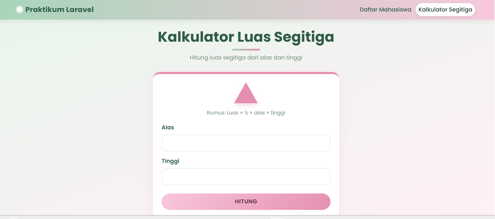
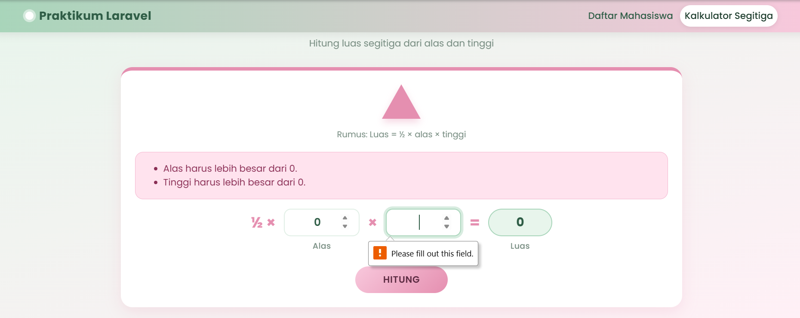

# Tugas Praktikum Framework Laravel

Tugas praktikum Pemrograman Web menggunakan framework Laravel. Materi yang
dipraktikkan meliputi Route, Controller, Parsing Data ke View, Sistem
Templating Blade, CRUD dengan Eloquent, Migration, Seeder dan Factory, serta
Autentikasi dengan Session dan Middleware.

- **Nama:** Maya Puspa Wardhani
- **NPM:** 2513020073
- **Repository:** https://github.com/mayapuspa999-hash/laravel-2A

## Deskripsi

Aplikasi ini dikerjakan bertahap mengikuti Modul Praktikum Framework Laravel.

**Latihan sebelumnya** (tanpa login):

1. **Daftar Mahasiswa** (`/daftar/mahasiswa`): menampilkan data mahasiswa
   (Nama, Alamat, Gender) dalam bentuk tabel.
2. **Kalkulator Luas Segitiga** (`/kalkulator/segitiga`): form untuk menghitung
   luas segitiga (`1/2 x alas x tinggi`) lengkap dengan validasi input.

**Praktikum lanjutan** (Sistem Templating sampai Autentikasi):

1. **Sistem Templating**: halaman dashboard dengan layout header, banner,
   sidebar, dan konten yang dipisah menjadi beberapa file Blade.
2. **CRUD**: pengelolaan data pegawai (tabel `employes`) dengan fitur tampil,
   tambah, ubah, dan hapus data memakai Eloquent ORM.
3. **Migration, Seeder dan Factory**: pembuatan tabel lewat file migration dan
   pengisian data dummy otomatis memakai Seeder dan Faker.
4. **Autentikasi**: halaman login dengan session, logout, dan pembatasan
   halaman memakai Middleware.

Data dikirim dari Controller ke View menggunakan array `$data`, lalu
ditampilkan dengan Blade (`{{ }}`, `@foreach`, `@forelse`, dan `@if`).

## Teknologi

- PHP 8.5.12 atau lebih baru
- Laravel 13.40.0
- Composer
- MySQL (XAMPP) dengan database `company`
- Bootstrap 5.3 (CDN) dan CSS

## Daftar Fitur Praktikum Lanjutan

### 1. Sistem Templating

Layout dashboard dibagi menjadi beberapa bagian dengan `@extends`, `@include`,
dan `@yield`. Halaman Home, Gallery, About, dan CRUD memakai satu template
yang sama (`dashboard.blade.php`) sehingga cukup menulis isi kontennya saja.
Tampilan dashboard memakai `dashboard.css` yang terpisah dari tema pastel
(`style.css`) milik latihan sebelumnya.

### 2. CRUD (Create, Read, Update, Delete)

Pengelolaan data pegawai pada tabel `employes` lewat `EmployeController` dan
model `Employe`:

- **Read**: menampilkan semua data pegawai dalam tabel
- **Create**: form tambah data dan penyimpanan ke database
- **Update**: form edit dan perubahan data berdasarkan ID
- **Delete**: penghapusan data dengan konfirmasi

### 3. Migration, Seeder dan Factory

- **Migration**: struktur tabel `users` dan `employes` dibuat lewat file
  migration, bukan SQL manual
- **Seeder**: `UserSeeder` membuat akun admin dan `EmployeSeeder` membuat 10
  data pegawai dummy memakai Faker
- `DatabaseSeeder` memanggil kedua seeder sehingga cukup satu perintah

### 4. Autentikasi

- Halaman login (`/`) memeriksa email dan password (di-hash) dari tabel `users`
- Data login disimpan di session, lalu pengguna diarahkan ke dashboard
- Middleware `IsLogin` (alias `islogin`) melindungi halaman dashboard, gallery,
  about, dan CRUD
- Logout menghapus session dan mengembalikan pengguna ke halaman login

## Daftar Halaman (Route)

### Latihan sebelumnya

| Method | URL                    | Controller             | Fungsi           | Keterangan             |
| ------ | ---------------------- | ---------------------- | ---------------- | ---------------------- |
| GET    | `/daftar/mahasiswa`    | `MahasiswaController`  | `index`          | Tabel daftar mahasiswa |
| GET    | `/kalkulator/segitiga` | `KalkulatorController` | `segitiga`       | Form luas segitiga     |
| POST   | `/kalkulator/segitiga` | `KalkulatorController` | `hitungSegitiga` | Proses hitung luas     |

### Praktikum lanjutan

| Method | URL                  | Controller            | Fungsi    | Login | Keterangan         |
| ------ | -------------------- | --------------------- | --------- | ----- | ------------------ |
| GET    | `/`                  | (closure)             | -         | Tidak | Halaman login      |
| POST   | `/login`             | `AuthController`      | `cek`     | Tidak | Proses login       |
| GET    | `/logout`            | `AuthController`      | `logout`  | Ya    | Logout             |
| GET    | `/dashboard`         | `DashboardController` | `home`    | Ya    | Halaman Home       |
| GET    | `/gallery`           | `DashboardController` | `gallery` | Ya    | Halaman Gallery    |
| GET    | `/about`             | `DashboardController` | `about`   | Ya    | Halaman About      |
| GET    | `/employe`           | `EmployeController`   | `index`   | Ya    | Tabel data pegawai |
| GET    | `/employe/create`    | `EmployeController`   | `create`  | Ya    | Form tambah data   |
| POST   | `/employe/store`     | `EmployeController`   | `store`   | Ya    | Simpan data baru   |
| GET    | `/employe/edit/{id}` | `EmployeController`   | `show`    | Ya    | Form edit data     |
| PUT    | `/employe/{id}`      | `EmployeController`   | `update`  | Ya    | Ubah data          |
| DELETE | `/employe/{id}`      | `EmployeController`   | `destroy` | Ya    | Hapus data         |

## Struktur File Penting

```
web-app
 |- app
 |    |- Http
 |    |    |- Controllers
 |    |    |    |- MahasiswaController.php     (latihan)
 |    |    |    |- KalkulatorController.php    (latihan)
 |    |    |    |- DashboardController.php     (templating)
 |    |    |    |- EmployeController.php       (CRUD)
 |    |    |    |- AuthController.php          (autentikasi)
 |    |    |- Middleware
 |    |         |- IsLogin.php                 (autentikasi)
 |    |- Models
 |         |- Employe.php                      (CRUD)
 |         |- User.php
 |- bootstrap
 |    |- app.php                                (alias middleware islogin)
 |- database
 |    |- migrations                            (tabel users dan employes)
 |    |- seeders
 |         |- DatabaseSeeder.php
 |         |- UserSeeder.php
 |         |- EmployeSeeder.php
 |- public/css
 |    |- style.css                             (tema hijau mint + pink pastel)
 |    |- dashboard.css                         (tema dashboard)
 |- resources/views
 |    |- template
 |    |    |- header.blade.php                 (navbar pastel)
 |    |    |- footer.blade.php
 |    |    |- dash_header.blade.php            (header dashboard)
 |    |    |- dash_sidebar.blade.php           (sidebar dashboard)
 |    |- layout.blade.php                      (template latihan)
 |    |- mahasiswa.blade.php                   (latihan)
 |    |- segitiga.blade.php                    (latihan)
 |    |- dashboard.blade.php                   (template dashboard)
 |    |- home.blade.php
 |    |- gallery.blade.php
 |    |- about.blade.php
 |    |- tampil_data.blade.php                 (CRUD)
 |    |- tambah_data.blade.php                 (CRUD)
 |    |- edit_data.blade.php                   (CRUD)
 |    |- login.blade.php                       (autentikasi)
 |- routes
 |    |- web.php
 |- screenshots                                (gambar untuk README)
```

## Cara Menjalankan

1. Clone repository dan masuk ke foldernya:

    ```
    git clone https://github.com/mayapuspa999-hash/laravel-2A.git
    cd laravel-2A
    ```

2. Install dependency (jika folder `vendor` belum ada):

    ```
    composer install
    ```

3. Siapkan file environment (jika belum ada `.env`):

    ```
    copy .env.example .env
    php artisan key:generate
    ```

4. Jalankan **Apache** dan **MySQL** di XAMPP, lalu buat database kosong
   bernama `company` lewat phpMyAdmin.

5. Atur koneksi database di file `.env`:

    ```
    DB_CONNECTION=mysql
    DB_HOST=127.0.0.1
    DB_PORT=3306
    DB_DATABASE=company
    DB_USERNAME=root
    DB_PASSWORD=

    SESSION_DRIVER=file
    CACHE_STORE=file
    QUEUE_CONNECTION=sync
    ```

6. Jalankan migration dan seeder (membuat tabel dan mengisi data dummy):

    ```
    php artisan migrate:fresh --seed
    ```

7. Jalankan server:

    ```
    php artisan serve
    ```

8. Buka di browser:
    - http://localhost:8000/ (login)
    - http://localhost:8000/daftar/mahasiswa
    - http://localhost:8000/kalkulator/segitiga

> Koneksi internet diperlukan karena Bootstrap dan font dimuat lewat CDN, dan
> gambar banner dashboard diambil dari picsum.photos.

## Akun Login

Akun berikut dibuat otomatis oleh `UserSeeder`:

| Email            | Password |
| ---------------- | -------- |
| `admin@mail.com` | `123456` |

## Contoh Pengujian

**Latihan sebelumnya**

- `/daftar/mahasiswa` menampilkan 4 baris: Anton, Budi, Ani, Sinta.
- `/kalkulator/segitiga`: isi alas `10` dan tinggi `5`, klik **HITUNG**,
  hasilnya **25**.
- `/kalkulator/segitiga`: kosongkan kolom atau isi `0`, akan muncul pesan
  kesalahan validasi.
- `/kalkulator/segitiga`: isi alas `0` dan tinggi `0`, klik **HITUNG**, akan
  muncul pesan "Alas harus lebih besar dari 0" dan "Tinggi harus lebih besar
  dari 0".

**Praktikum lanjutan**

- **Autentikasi**: login dengan `admin@mail.com` dan `123456`, langsung masuk
  ke `/dashboard`. Login dengan password salah menampilkan pesan "Email atau
  password salah!".
- **Pembatasan halaman**: setelah logout, membuka `/dashboard` atau `/employe`
  langsung mengarahkan ke halaman login.
- **Sistem Templating**: menu Home, Gallery, dan About menampilkan layout yang
  sama (header, banner, sidebar) dengan konten berbeda.
- **CRUD**: `/employe` menampilkan 10 data pegawai dari seeder. Coba tombol
  **Tambah Data**, **Edit**, dan **Delete**; setiap aksi kembali ke tabel.
- **Migration dan Seeder**: perintah `php artisan migrate:fresh --seed`
  menghasilkan tabel `users` (1 baris) dan `employes` (10 baris) tanpa error.

## Riwayat Commit

Setiap bab praktikum lanjutan di-commit terpisah sesuai nama babnya:

| Bab                           | Pesan commit                                |
| ----------------------------- | ------------------------------------------- |
| Sistem Templating             | `[ADD] fitur Sistem Templating`             |
| CRUD                          | `[ADD] fitur Crud`                          |
| Migration, Seeder dan Factory | `[ADD] fitur Migration, Seeder dan Factory` |
| Autentikasi                   | `[ADD] fitur Autentikasi`                   |

## Screenshot

Screenshot berikut untuk latihan Route, Controller, dan Parsing Data ke View.

### 1. Daftar Mahasiswa (`/daftar/mahasiswa`)


### 2. Kalkulator Segitiga, sebelum dihitung (`/kalkulator/segitiga`)



### 3. Kalkulator Segitiga, setelah dihitung


### 4. Kalkulator Segitiga, pesan validasi (alas dan tinggi diisi 0)



## Referensi

- Modul Praktikum Framework Laravel, Rudy Eko Prasetya, S.Kom
- Dokumentasi Laravel: https://laravel.com/docs
- Dokumentasi Bootstrap: https://getbootstrap.com/docs/5.3

---

<p align="center"><a href="https://laravel.com" target="_blank"></a></p>

<p align="center">
<a href="https://github.com/laravel/framework/actions"></a>
<a href="https://packagist.org/packages/laravel/framework"></a>
<a href="https://packagist.org/packages/laravel/framework"></a>
<a href="https://packagist.org/packages/laravel/framework"></a>
</p>

## About Laravel

Laravel is a web application framework with expressive, elegant syntax. We believe development must be an enjoyable and creative experience to be truly fulfilling. Laravel takes the pain out of development by easing common tasks used in many web projects, such as:

- [Simple, fast routing engine](https://laravel.com/docs/routing).
- [Powerful dependency injection container](https://laravel.com/docs/container).
- Multiple back-ends for [session](https://laravel.com/docs/session) and [cache](https://laravel.com/docs/cache) storage.
- Expressive, intuitive [database ORM](https://laravel.com/docs/eloquent).
- Database agnostic [schema migrations](https://laravel.com/docs/migrations).
- [Robust background job processing](https://laravel.com/docs/queues).
- [Real-time event broadcasting](https://laravel.com/docs/broadcasting).

Laravel is accessible, powerful, and provides tools required for large, robust applications.

## Learning Laravel

Laravel has the most extensive and thorough [documentation](https://laravel.com/docs) and video tutorial library of all modern web application frameworks, making it a breeze to get started with the framework.

In addition, [Laracasts](https://laracasts.com) contains thousands of video tutorials on a range of topics including Laravel, modern PHP, unit testing, and JavaScript. Boost your skills by digging into our comprehensive video library.

## Contributing

Thank you for considering contributing to the Laravel framework! The contribution guide can be found in the [Laravel documentation](https://laravel.com/docs/contributions).

## Code of Conduct

In order to ensure that the Laravel community is welcoming to all, please review and abide by the [Code of Conduct](https://laravel.com/docs/contributions#code-of-conduct).

## Security Vulnerabilities

If you discover a security vulnerability within Laravel, please send an e-mail to Taylor Otwell via [taylor@laravel.com](mailto:taylor@laravel.com). All security vulnerabilities will be promptly addressed.

## License

The Laravel framework is open-sourced software licensed under the [MIT license](https://opensource.org/licenses/MIT).
